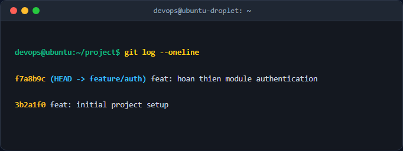

# Báo cáo kỹ thuật: Tái cấu trúc lịch sử commit bằng Interactive Rebase

## 1. Mục tiêu & Bối cảnh kỹ thuật
Tài liệu này ghi lại quá trình sử dụng công cụ Interactive Rebase trong Git để dọn dẹp lịch sử commit cục bộ của nhánh tính năng trước khi đẩy lên remote repository. Mục tiêu là gộp các commit vụn vặt (fix typo, add helper) thành một commit duy nhất có ý nghĩa, cập nhật lại thông điệp commit theo chuẩn Conventional Commits, và xóa bỏ hoàn toàn các commit chứa file rác không cần thiết.

Môi trường thực hiện: Linux Ubuntu Terminal, Git VCS.

## 2. Các bước thực hiện chi tiết

### Bước 1: Khởi tạo các commit thử nghiệm mẫu
Tạo các thay đổi tương ứng với module authentication và file rác debug trên nhánh làm việc hiện tại:
```bash
echo "public class Auth { }" > auth.js
git add auth.js && git commit -m "feat: khoi tao module auth"

echo "public class Auth { // fixed typo }" > auth.js
git add auth.js && git commit -m "fix typo"

echo "public class Auth { // added utils }" > auth.js
git add auth.js && git commit -m "adds utility functions"

echo "debug data" > temp.txt
git add temp.txt && git commit -m "add temp file for debug"
```
*Giải thích các cờ và lệnh:* 
- `git add`: Đưa các thay đổi vào khu vực staging area.
- `git commit -m`: Tạo commit kèm theo thông điệp trực tiếp trên dòng lệnh.

### Bước 2: Thực hiện Interactive Rebase
Chạy lệnh rebase tương tác lùi về 4 commit trước đó để tiến hành chỉnh sửa lịch sử:
```bash
git rebase -i HEAD~4
```
*Giải thích tham số:* `-i` (Interactive) kích hoạt chế độ tương tác, `HEAD~4` chỉ định phạm vi bao gồm 4 commit gần nhất tính từ con trỏ HEAD hiện tại.

Trong trình soạn thảo hiển thị, cấu hình lại các hành động cho từng commit như sau:
```text
pick a1b2c3d feat: khoi tao module auth
squash e4f5g6h fix typo
squash 7h8i9j0 adds utility functions
drop 1a2b3c4 add temp file for debug
```
*Giải thích các từ khóa:* 
- `pick`: Giữ nguyên commit.
- `squash` (hoặc `s`): Gộp commit hiện tại vào commit phía trên và cho phép chỉnh sửa thông điệp.
- `drop` (hoặc `d`): Xóa bỏ hoàn toàn commit này khỏi lịch sử.

### Bước 3: Cập nhật thông điệp commit gộp
Sau khi lưu cấu hình rebase, Git sẽ mở tiếp trình soạn thảo để nhập thông điệp mới cho commit đã gộp. Thay thế toàn bộ nội dung cũ bằng:
```text
feat: hoan thien module authentication
```

## 3. Kiểm tra & Xác thực kết quả
Thực hiện lệnh kiểm tra lịch sử commit gọn gàng sau khi quá trình rebase hoàn tất:
```bash
git log --oneline
```

Kết quả hiển thị trên terminal:


## 4. Kết luận & Best Practices bảo mật vận hành
- **Clean History:** Lịch sử commit sạch sẽ, rõ ràng giúp các thành viên trong đội ngũ dễ dàng code review và truy vết lỗi (git blame).
- **Conventional Commits:** Tuân thủ đặt tên thông điệp commit giúp tự động hóa việc sinh changelogs và quản lý phiên bản phần mềm.
- **Lưu ý an toàn:** Tuyệt đối không thực hiện `git rebase -i` trên các nhánh chia sẻ công khai (như `main` hoặc `develop`) nếu đã push lên remote, tránh gây xung đột lịch sử cho các thành viên khác.